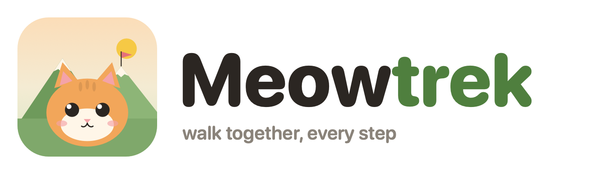

# Meowtrek

SwiftUI step tracker with a cat companion. Walk to earn coins, dress up your cat, explore landmarks and seasonal events.

## Run

Open `Meowtrek.xcodeproj` in Xcode 26, pick an iPhone simulator, Run. iOS 17+.

Steps come from Apple Health (plus live CoreMotion pedometer). With no Health data the app shows demo steps.
Launch arguments for development: `-demo` (skip Health and onboarding), `-tab N` (start on tab N), `-closet` (open the closet).

Website: https://giankbr.github.io/meowtrek/ (source in `site/`, deployed by GitHub Pages).

## Layout

- `Meowtrek/` — app (screens, state, HealthKit, notifications)
- `Shared/` — code and `content.json` shared with the widget
- `MeowtrekWidget/` — home and lock screen widget
- `Shared/content.json` — items, treats, events, daily quest pool, landmarks, badges. Edit to add content, no Swift needed.

## Commits

Conventional commits, enforced by husky + commitlint. Run `npm install` once after cloning.
