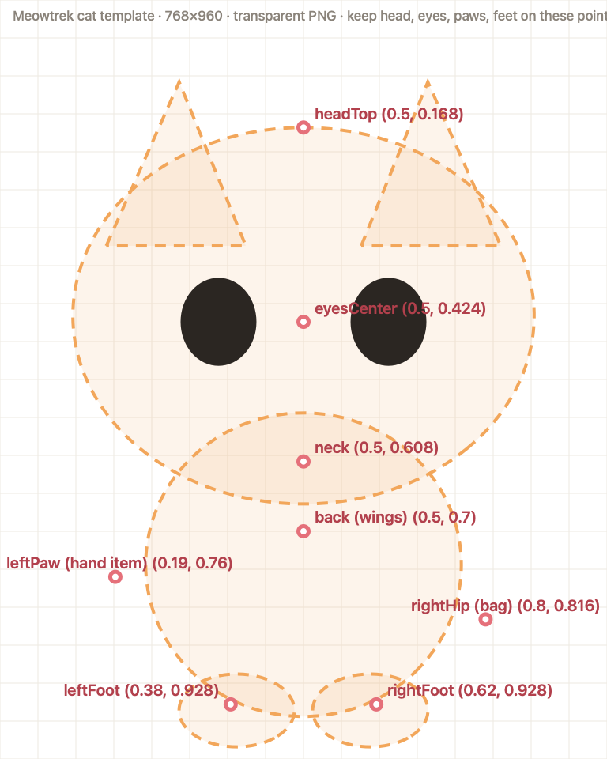

# Meowtrek — illustration brief

Meowtrek is an iPhone step tracker where a small cat walks with you. You earn coins by walking and dress the cat up in a wardrobe of hats, glasses, scarves, bags and shoes. We need the cat and every wardrobe item drawn as real illustrations; today they are placeholder vector shapes.



## Style

- Cozy, soft, chibi/kawaii pet-game look (think Neko Atsume, Tamagotchi, cozy mobile games), not a flat icon set.
- Soft pastel palette that sits on a cream background `#F7F4EC`; key app colours: leaf green `#7FA86B`, honey `#F6C945`, rose `#E5707A`, lilac `#8B7BC8`, sky `#8CC4DE`.
- Thin, soft outline in a darker shade of each fill colour (not pure black), gentle shading, light from the top left.
- Cat: big round head, big glossy eyes with two highlights, pink blush, small body, short legs, curled tail. Friendly and calm, slightly cheeky.
- Every asset must read clearly at 40 px and still look good at 200 px.

## Deliverables

The full list with file names, sizes and notes is in [`asset-list.csv`](asset-list.csv) — **94 assets**, of which **51 are P1** (first batch) and 43 are P2.

| Group | Count | Canvas | Notes |
|---|---|---|---|
| Cat bodies | 30 | 768×960 | 6 fur colours × (base + 4 outfits). Exactly the template pose. |
| Wardrobe items | 43 | 512×512 | Hats, eyes, neck, hand, bag, shoes, outfit thumbnails |
| Treats | 5 | 512×512 | Milk, fish, sushi, cake, ice-cube "streak freeze" |
| Currency & UI | 4 | 512×512 | Coin, gem, chest, glass of water |
| Event tokens & scene props | 12 | 512×512 | Candy, snowflake, petal, shell; trees, lamp, cloud… |

### Cat bodies (most important)

- Use [`cat-template.png`](cat-template.png): canvas **768×960**, cat centred, feet near the bottom. Hats, glasses, scarves, bags, items and shoes are placed by the app on the red anchor points, so **head, eyes, paws and feet must sit on those points in every cat image**.
- Draw the cat **without** accessories, facing front, standing, neutral happy face, eyes open.
- 6 fur colours (hex in the CSV): Ginger, Snow, Smoky, Cocoa, Peach, Lilac. A layered source where the fur colour is one layer is ideal.
- 4 outfit variants per fur (cat wearing them, face visible): frog kigurumi with hood + frog eyes, bear kigurumi with hood + ears, purple witch cloak with stars, white ghost sheet. P1 = ginger only; other furs are P2.

### Items (512×512)

- One object per file, centred, about 6% padding, no shadow on the ground, no text.
- **Hats:** worn view from the front; the bottom edge is where it sits on the head.
- **Eyes (glasses, goggles, mask):** front, horizontal; lens centres at 28% and 72% of the width, 50% height.
- **Neck:** collar/scarf running across the middle.
- **Hand items:** upright; the grip point is the centre of the canvas.
- **Bags:** front view. Bat wings and butterfly are drawn spread, as if behind the cat.
- **Shoes:** ONE shoe, side view, **toe pointing right** — the app mirrors it for the other foot.

## Technical

- PNG, sRGB, **transparent background**, no colour profile tricks.
- File name exactly as in the CSV (e.g. `top_hat.png`, `cat_fur_ginger.png`, `cat_fur_snow_frog_suit.png`).
- Also deliver the layered sources (PSD / Procreate / Figma), with fur colour on its own layer for the cat.
- Optional, later: mood face overlays for the cat (happy ^^, sleepy, hungry) as separate layers on the same canvas.

## Rights

Work-for-hire with full, exclusive commercial rights transferred to the client (the app is sold on the App Store with in-app purchases). No AI-generated imagery.

## Hand-off

Send a zip of PNGs. Import is one command:

```bash
python3 -I scripts/import-art.py ~/Downloads/meowtrek-art
```

It copies every correctly named PNG into `Shared/Art.xcassets`, reports what's still missing, and the app picks them up automatically (vector placeholders stay for anything not delivered yet). Anchor points live in `Shared/cat_anchors.json` and only need changing if the template pose changes.
